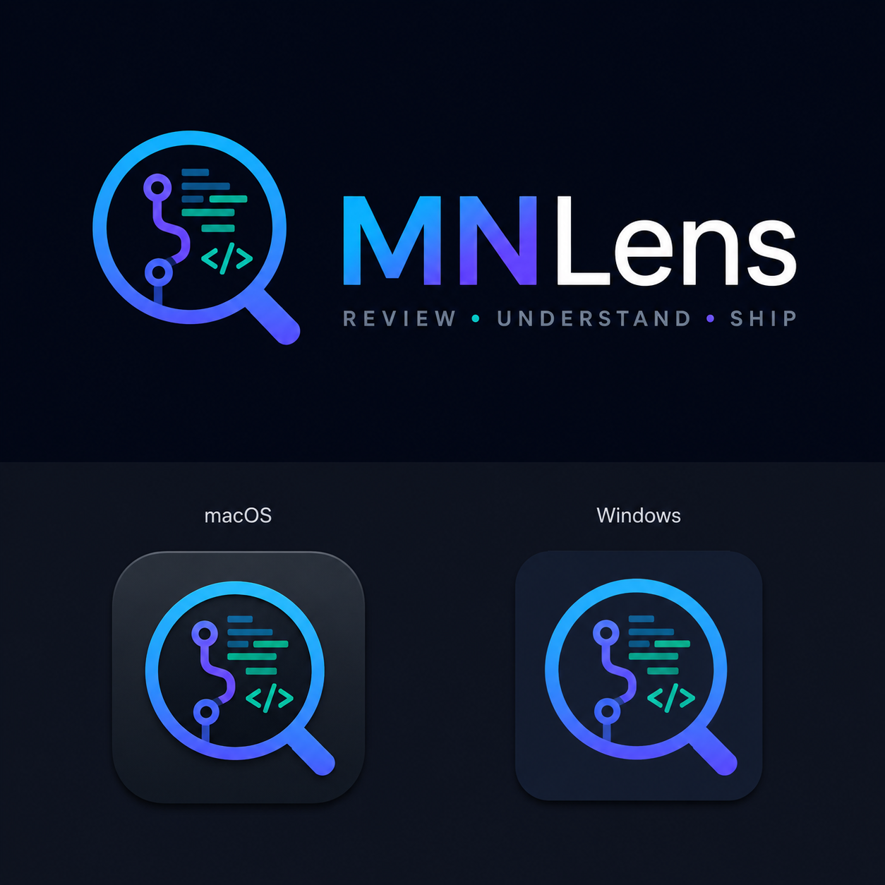

<p align="center">
  
</p>

# MNLens

**MNLens is a local-first GitHub pull request review workstation.** It brings queue triage, stacked-PR awareness, linked issues, CI status, review comments, risk analysis, test planning, research, agent-assisted fixes, local verification, artifacts, and final handoff into one human-controlled review flow.

MNLens is not a hosted bot. It runs on your machine, uses your local `gh`, `git`, and coding-agent CLI (**Codex** or **Claude Code**, your choice), stores data locally, and keeps review submission, commits, rebases, and pushes behind explicit human approval.

> [!IMPORTANT]
> This project was vibe coded. Treat it like an early beta: inspect the code, validate workflows on your machine, and keep human review in the loop before trusting generated analysis or code changes.

## Quick Start

```sh
git clone https://github.com/n0tl3ss/MNLens && cd MNLens
npm install
# one coding agent, signed in:
claude auth login            # Claude Code   (or: brew install codex && codex login)
npm run dev                  # http://localhost:4321
```

On first launch the setup screen checks `git`, `gh`, your agent CLI and the OS credential store, then asks for a GitHub token (see [permissions](#github-token-permissions)). Pick **Agent & models** in the sidebar to choose Codex or Claude Code and the model tier per task.

## How A Review Flows

1. **Queue** — Fast Analyze scores the visible PRs from metadata (no agent call); stacked PRs show a `2/3` badge.
2. **Deep Analyze** — the agent (standard tier) returns a structured review: classification, evidence, reviewer focus, risks, test assessment, research, draft comment. Repo rules and your past 👍/👎 verdicts calibrate the prompt.
3. **Acceptance contract** — criteria from the linked issue / PR body are mapped to proof (tests, `path:line`, CI, local runs). Unproven holds, failed blocks; you can override.
4. **Review tab** — the review the agent would actually post: inline comments anchored to diff lines (blocking / important / question / suggestion / nit / praise), a final review comment, and a verdict, laid out as an ordered procedure with **Mandatory → Recommended → Optional → Decide** tiers. "Add to my review" copies a suggested comment into your own draft; "Use as review comment" fills the review dialog. You still choose Approve / Request changes yourself.
5. **Second opinion** (optional, economy tier) — the other vendor's model audits the analysis and reports disputes and misses.
6. **Verify / Fix** — run the suggested commands locally, or let the agent prepare a patch through the research → implementation → tests/QA → docs → security → final-review pipeline in a disposable worktree. Nothing is committed or pushed until you approve.
7. **Handoff** — copy the handoff note, or post one structured **Feedback to author** comment (criteria table, kept findings, verification) with your identity.

## Why It Exists

Code review work is usually scattered across GitHub tabs, CI logs, local terminals, notes, and AI chats. MNLens turns a PR into a structured review session:

- What changed?
- What matters most in source code, tests, docs, and CI?
- Which comments are unresolved?
- Which checks can be automated instead of left as reviewer memory?
- Can the agent prepare a focused patch without pushing it?
- What should the human reviewer approve, request, or hand off?

## Features

- **Review queue:** assigned PRs, review-requested PRs, optionally your own PRs.
- **Pluggable coding agent:** run every AI step on **Codex CLI** or **Claude Code**. Same prompts, same JSON schemas, same approval gates; switch under *Agent & models*.
- **Cost-tiered model routing:** each task is mapped to an *economy / standard / premium* tier (see below), so Q&A, docs and triage run on ~20x cheaper models than code edits.
- **Recommended review (Review tab):** the agent drafts the review it would post — line-anchored comments with a kind, body and reviewer-only rationale, the final comment, and an APPROVE / REQUEST_CHANGES / COMMENT verdict — plus a must / should / optional checklist for the human. Anchors are validated against the diff, so a suggested comment drops into your draft without GitHub rejecting it; anything the agent could not anchor is flagged "place manually". Nothing is posted until you submit.
- **Focused Overview:** the first screen is the decision — recommendation, summary, acceptance contract, second opinion and the evidence / focus / risk columns. PR context, project, readiness and the rules & memory tooling sit in collapsible groups that remember their state.
- **Team sharing:** rules committed in the repo (`.mnlens/review-rules.json`), a shared team folder for rules + review memory (per-machine memory files merged on read), and a per-repo agent-accuracy score from kept/dismissed suggested comments. See *Team Use*.
- **Review-flow tab layout:** tabs are grouped **Understand** (Overview, Research, Commits) → **Review** (Review, Plan, Diff) → **Act** (agent fix, Comment, Handoff), with counters for suggested and drafted comments.
- **Acceptance contract:** the agent extracts acceptance criteria from linked issues and the PR body, then marks each one proven / unproven / failed / n/a with concrete evidence (test name, `path:line`, CI check, local run). You can override any verdict; unproven criteria hold the recommendation, failed ones block it. The contract flows into the handoff and the author comment.
- **Review memory:** 👍 / 👎 on any finding records your verdict per repository. Verdicts calibrate future Deep Analyze prompts ("reviewers dismissed this 4x"), surface as patterns, and can be promoted to repo rules in one click.
- **Feedback to author:** build a single structured, human-edited comment (criteria table with evidence, kept findings, second-opinion notes, local verification) and post it to the PR with your identity.
- **Stack merge plan:** bottom-up readiness per PR in the stack (approved, clean, not draft, parent merged, merge-queue aware) and a guarded **Merge #root** that refuses to merge out of order; children are retargeted by GitHub and offered for restack.
- **Live updates:** job state streams to the UI over server-sent events (polling remains as fallback).
- **Second opinion:** one click asks the *other* agent (economy tier) to audit the deep analysis against the diff and report disputed findings, misses, and problems in the draft comment. Two vendors rarely hallucinate the same risk.
- **Agent spend ledger:** every agent run is recorded per PR (task, agent, model, tier, duration, cost when the CLI reports it) and shown in the Overview.
- **Stale-analysis detection:** cached analyses are fingerprinted against comments, reviews, linked issues and base branch; the Overview flags when the discussion moved on, and Deep Analyze refreshes automatically.
- **Research profiles:** technology-specific research (code-search queries, curated references, prompt guidance) is data in `research-profiles.json`, not code.
- **Stacked PRs:** MNLens detects PRs whose base branch is another open PR's head, shows the chain (root → leaf), your position in it, parent/children state, and a one-click *Restack onto parent* preview. Analysis prompts know the diff is incremental to the parent.
- **Fast Analyze visible:** lightweight scoring for queue triage without running a deep agent review for every PR.
- **Deep Analyze:** richer agent-backed review guidance with evidence, risks, test quality, research, and final comment draft.
- **Review tabs:** Overview, Plan, Diff, Commits, Research, Codex/Claude, Comment, and Handoff.
- **Reviewer Focus:** unresolved GitHub line comments are promoted into actionable review items with agent actions.
- **Code-aware diff viewer:** file review state, overview pins, inline comment drafting, and `Cmd/Ctrl+F` find inside code views.
- **CI interpretation:** failing checks can be explained or addressed through the agent.
- **Tests To Check:** prefers runnable/local verification and doc-render artifacts over manual checklists.
- **Agent fix sessions:** run, retry, continue, guide, cancel, inspect logs, and review prepared code changes before push.
- **Artifacts:** generated screenshots, rendered docs, logs, and review bundles.
- **GitHub Projects:** attach a PR, and optionally linked issues, to organization/user Projects V2 when token permissions allow it.
- **Local data controls:** export review bundles or clear local cache/worktrees/artifacts.
- **Desktop app:** Electron wrapper that starts the local server and opens MNLens in a native window.

## Requirements

Required:

- Node.js 20+
- Git
- GitHub CLI (`gh`)
- **One** coding-agent CLI, signed in:
  - Codex CLI (`codex`), or
  - Claude Code (`claude`)
- OS secure credential store:
  - macOS Keychain
  - Windows Credential Manager
  - Linux Secret Service/libsecret

Recommended for verification workflows:

- Java/JDK
- Gradle or project Gradle wrappers
- Maven or project Maven wrappers
- Agent Browser CLI (`agent-browser`) for **Build docs + screenshot** artifacts

The first-run setup screen checks required tools and displays install hints. MNLens does not bundle Codex, Claude Code or browser-agent tooling because those CLIs change frequently and need their own authentication/runtime setup. Install them separately and keep them on your PATH.

Useful one-time checks:

```sh
# Codex
brew install codex
codex --version
codex --ask-for-approval never exec --skip-git-repo-check --sandbox read-only - <<< "Reply with exactly: OK"

# Claude Code
curl -fsSL https://claude.ai/install.sh | bash   # or: npm install -g @anthropic-ai/claude-code
claude --version
claude auth login            # subscription; or `claude auth login --console` / ANTHROPIC_API_KEY for API billing
claude auth status

# Docs screenshots
npm install -g agent-browser
agent-browser --version
```

## Choosing The Agent And Models

Open **Agent & models** in the queue sidebar (or edit `agent-settings.json` in the cache directory). MNLens drives the selected CLI non-interactively:

| | Codex | Claude Code |
| --- | --- | --- |
| Command | `codex exec` | `claude -p --output-format json` |
| Read-only steps (analysis, Q&A, manual checks) | `--sandbox read-only` | `--permission-mode dontAsk` + edit tools removed |
| Fix pipeline / conflict resolution | `--sandbox danger-full-access` in a disposable worktree | `--permission-mode bypassPermissions` in the same worktree |
| Structured analysis | `--output-schema` | `--json-schema` |
| Resume a fix session | `codex exec resume <id>` | `--resume <session_id>` |
| Model / effort | `-m <model> -c model_reasoning_effort=<x>` | `--model <alias> --effort <x>` |
| Spend guard | model + effort only | `--max-budget-usd` |

Every task is assigned a **tier**, and every tier maps to a model per agent:

| Tier | Claude default | Codex default | Used for |
| --- | --- | --- | --- |
| economy | `haiku` (low effort) | `gpt-6-luna` (low) | risk/CI/research Q&A, fix-session questions, research & docs passes, QA failure classification, manual-check investigation, setup probe |
| standard | `sonnet` (medium) | `gpt-6.1-sol` (medium) | Deep Analyze, review draft, acceptance contract, implementation, tests/QA, security and final-review passes, rebase/merge conflict resolution |
| premium | `opus` (high) | `gpt-6-astra` (high) | never by default; opt in per task for unusually hard PRs |

At Oct 2026 list prices the economy tier is roughly 20x cheaper than standard on both vendors (≈$0.10/$0.50 vs ≈$2/$10 per 1M input/output tokens), and premium is 2–5x standard. Claude aliases always resolve to the newest model in that family; OpenAI ids are explicit and should match what your account exposes to Codex. Environment overrides: `MNLENS_AGENT=codex|claude`, `MNLENS_AGENT_SETTINGS_JSON='{...}'`, `MNLENS_CLAUDE_CONFIG_DIR`.

Running fix sessions keep the agent they started with; switching agents applies to new analyses and sessions.

### Agent instruction sets

The prompts MNLens gives the agents live in `src/server/agentSkills.ts`: shared operating rules (read the repo's AGENTS.md/CONTRIBUTING, never commit/push/comment, no secrets, cite file:line evidence, be economical), a fixed response contract for pipeline passes (SUMMARY / CHANGES / EVIDENCE / OPEN QUESTIONS / marker), and per-pass instructions for Research, Implementation, Tests/QA, Docs, Security and Final review, plus the manual-check and conflict-resolution rules.

### Research profiles

`<cache>/research-profiles.json` (or `MNLENS_RESEARCH_PROFILES_JSON`) holds an array of profiles with `triggers`, `codeSearchQueries`, `exactMatchTerms`, `relevanceTerms`, `curatedSources` and `promptGuidance`. Built-ins cover Oracle UCP/OpenTelemetry, generic framework instrumentation, and dependency/CVE updates; a user profile with the same `id` replaces a built-in, and `"enabled": false` turns one off.

## Stacked Pull Requests

A stack is a chain of open PRs where each PR's base branch is the previous PR's head branch (`main ← feat/schema ← feat/service ← feat/api`). MNLens rebuilds that graph from one GraphQL query per repository (cached for 5 minutes):

- Queue rows show a `2/3` stack badge; the PR header shows the full chain with draft/approved/conflict state and lets you jump between PRs in the stack.
- **Restack onto #parent** runs the existing branch-update preview against the parent branch. Nothing is pushed until you approve the preview.
- Deep Analyze receives the stack context, so the agent reviews the incremental diff and does not flag parent-PR code as missing.
- When a parent is merged and its branch deleted, GitHub retargets the child to the trunk; MNLens tells you the diff scope changed and to re-run analysis.

## Team Use

MNLens is local-first, but rules and review memory are more useful shared:

- **Rules committed in the repository** — maintainers commit `.mnlens/review-rules.json` (Overview → *Repository rules & review memory* → *Copy as .mnlens/review-rules.json* produces it from your current rules). MNLens reads it from the default branch for every reviewer, applies it to Deep Analyze and the review draft, and shows those rules with a `repo file` badge. They can be switched off locally without editing the file.
- **Shared team folder** — *Team sharing* in the sidebar (or `MNLENS_TEAM_DIR`) points MNLens at a folder the team already syncs: a git checkout, Dropbox / iCloud Drive, a network share. Repo rules are read from and written to `<folder>/<owner>__<repo>/rules.json`; review memory is written per machine (`memory/<user@host>.json`) and merged on read, so reviewers never overwrite each other and every 👍/👎 calibrates everyone's prompts. Turn it off and everything falls back to the local cache.
- **Agent accuracy** — every suggested comment you *Add to my review* or *Dismiss* on the Review tab is recorded. After three verdicts the tab shows the keep rate for the repository (and per comment kind in the tooltip); the calibration block tells the agent which kinds of comments reviewers rarely keep, so it raises fewer of them.

```json
{
  "version": 1,
  "rules": [
    { "id": "no-todo", "title": "No TODO markers", "body": "Do not add TODO/FIXME comments; open an issue instead.", "tone": "strict" },
    { "id": "tests", "title": "Tests for behavior changes", "body": "Every behavior change needs a test that fails without it." }
  ]
}
```

## GitHub Token Permissions

Prefer a fine-grained PAT limited to the repositories and organizations you review.

For read/review workflows:

- Metadata: read
- Contents: read
- Pull requests: read
- Issues: read
- Actions: read
- Checks: read
- Commit statuses: read
- Projects: read, if you want to list GitHub Projects

For write workflows:

- Pull requests: write, to submit reviews
- Issues: write, to reply in conversations where GitHub treats PRs as issues
- Projects: write, to attach PRs and linked issues to GitHub Projects
- Contents: write, only if you want MNLens to push approved fixes or rebases

Classic PAT fallback:

- `public_repo` can be enough for public repositories.
- `repo` is needed for private repositories or broad classic-token access.

## Local Development

Install dependencies:

```sh
npm install
```

Run the local server:

```sh
npm run dev
```

Open:

```text
http://localhost:4321
```

Useful validation commands:

```sh
npm run typecheck
npm test
npm run test:e2e
npm run build
```

## Desktop Builds

Run the desktop app in development mode:

```sh
npm run desktop:dev
```

Build unpacked desktop output:

```sh
npm run desktop:build
```

Build release packages:

```sh
npm run dist:mac
npm run dist:win
npm run dist:linux
```

The macOS DMG is produced under `release/`.

## macOS Signing And Notarization

`package.json` is configured for hardened-runtime signing and notarization (`build/entitlements.mac.plist` allows Electron's JIT and spawning `gh`/`git`/`codex`/`claude` from the packaged app). Notarization runs automatically when these are set in the environment of `npm run dist:mac`:

```sh
export CSC_LINK=/path/to/DeveloperID.p12      # or CSC_NAME="Developer ID Application: ..."
export CSC_KEY_PASSWORD=...
export APPLE_ID=you@example.com
export APPLE_APP_SPECIFIC_PASSWORD=xxxx-xxxx-xxxx-xxxx
export APPLE_TEAM_ID=XXXXXXXXXX
npm run dist:mac
```

Without those variables Electron Builder falls back to ad-hoc signing and skips notarization, which is fine for personal testing but not for public distribution. Auto-update with signed artifacts is still to do.

## Local Data

MNLens stores local state under `.pra-cache` in development and under the app user-data directory in packaged Electron builds. This can include:

- PR snapshots
- analysis results
- review progress
- agent (Codex/Claude) logs, session ids and worktrees
- agent model settings (`agent-settings.json`), usage ledger (`agent-usage.json`), team folder setting (`team-settings.json`)
- acceptance contracts (`acceptance/`), review memory per repository (`review-memory/`), research profiles
- verification logs
- rendered docs/screenshots/artifacts
- exported review bundles

Use **Export data** to create a review bundle. Use **Clear local data** to delete local cache, artifacts, worktrees, and review state.

## Beta Limitations

- The app is designed for local use and binds to localhost by default.
- Running jobs are recovered as interrupted/resumable after restart; external processes may need to be rerun.
- MNLens depends on locally installed CLIs and project toolchains.
- Agent-generated changes are only prepared for human review; pushing requires explicit approval.
- Stack detection covers the 200 most recently updated open PRs per repository and treats fork PRs as leaves only.
- Stack merging calls `gh pr merge` with your token and deletes the merged branch; it is only offered for the lowest ready PR and always behind a confirmation.
- The acceptance contract and second opinion are agent judgments; the reviewer's overrides win, and nothing is posted to GitHub without an explicit click.
- GitHub API rate limits matter. The UI displays remaining quota and backs off when limited, but heavy usage can still exhaust quota.
- The desktop app is not notarized yet.

## Security Model

- GitHub tokens are stored in the OS credential store when possible.
- **Agents never receive the reviewer's GitHub token.** Codex/Claude runs get `GH_TOKEN`/`GITHUB_TOKEN` stripped from their environment, and agent worktrees have git credential helpers cleared, so an agent cannot push, comment or review on its own even in full-access fix passes. MNLens performs pushes itself through an askpass script bound to its own process. Set `MNLENS_AGENT_GITHUB_TOKEN` to a separate read-only fine-grained token if agents should be able to read GitHub during research.
- GitHub Enterprise Server: set `MNLENS_GITHUB_HOST=github.example.com`.
- The local server requires an MNLens session token for API requests.
- MNLens should not be exposed on a public network.
- Generated code changes, rebases, reviews, and pushes must be inspected by a human before approval.

## License

Apache License 2.0. See [LICENSE](LICENSE).
